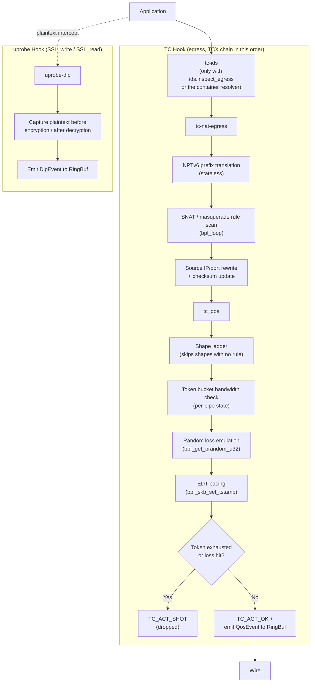
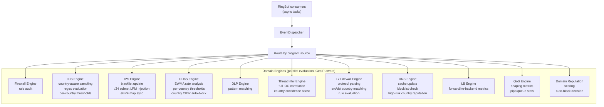
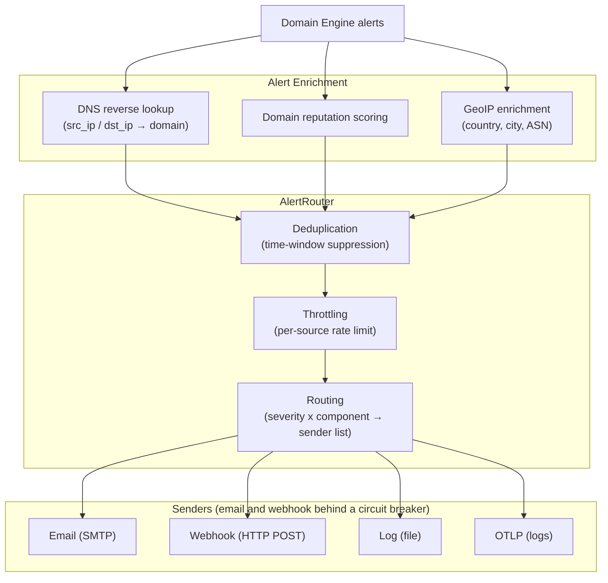
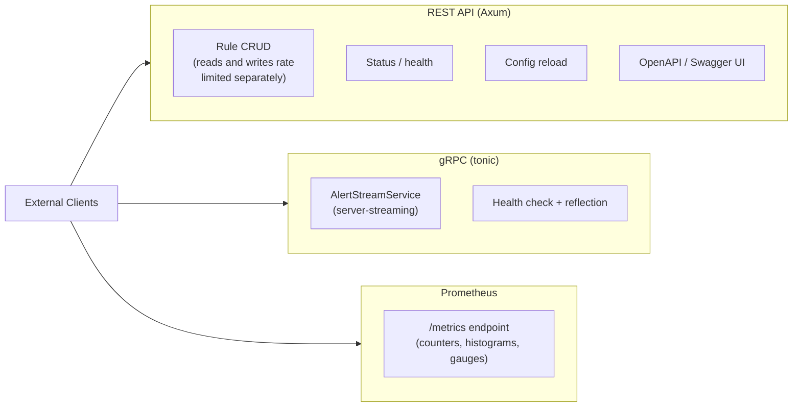
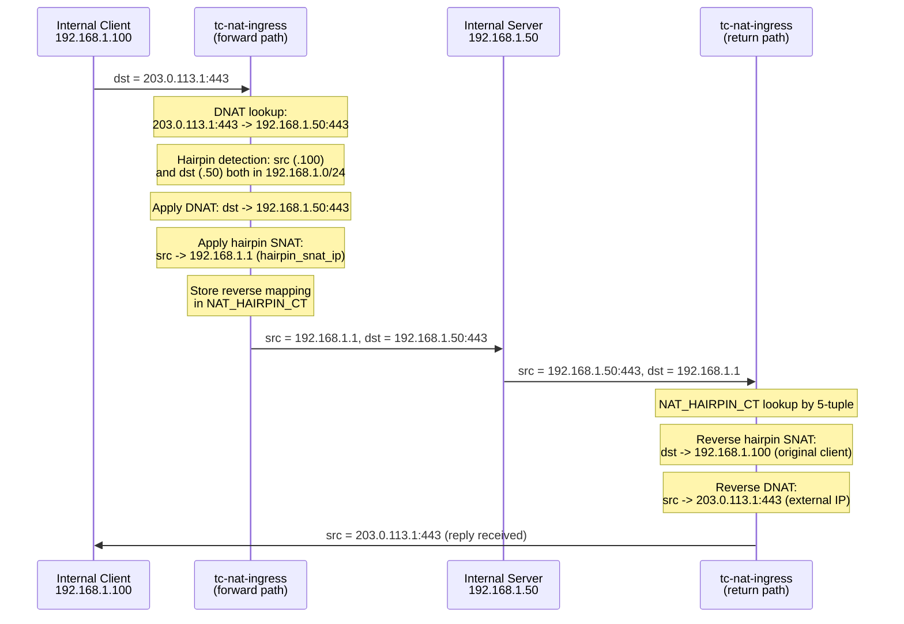
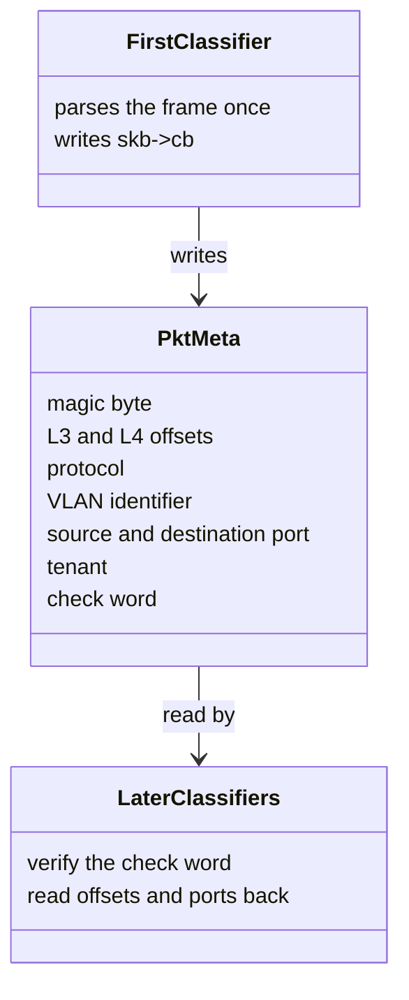

# Data Flow

## Packet Processing Pipeline

### 1. Ingress (Kernel)

```mermaid
flowchart TD
    NIC["Network Interface"]

    subgraph XDP["XDP Hook (earliest possible)"]
        FW["xdp-firewall"]
        FW_LPM["LPM trie lookup\n(CIDR rules)"]
        FW_SCAN["Linear scan\n(port/protocol/VLAN)"]
        FW --> FW_LPM --> FW_SCAN

        FW_DENY{"Denied?"}
        FW_SCAN --> FW_DENY
        FW_DROP_1["XDP_DROP +\nemit RingBuf event"]
        FW_DENY -- Yes --> FW_DROP_1

        FW_REJECT{"ACTION_REJECT?"}
        FW_DENY -- No --> FW_REJECT
        REJECT_PROG["xdp-firewall-reject\n(tail_call slot 1)"]
        FORGE_RST["Forge TCP RST /\nICMP Unreachable"]
        XDP_TX_1["XDP_TX\n(sent back)"]
        FW_REJECT -- Yes --> REJECT_PROG --> FORGE_RST --> XDP_TX_1

        FW_PASS["XDP_PASS\n(event only for a log rule;\nARP to a VIP tail-calls\nxdp-vip-announcer, slot 3)"]
        FW_REJECT -- No --> FW_PASS

        RL_ABSENT{"ratelimit\npresent?"}
        FW_PASS --> RL_ABSENT

        subgraph RATELIMIT["xdp-ratelimit (tail_call slot 0)"]
            RL_LPM["Country LPM tier lookup\n(RL_LPM_SRC_V4/V6)"]
            RL_DDOS["DDoS protections\n(SYN/ICMP/UDP amp/conntrack)"]
            RL_LPM --> RL_DDOS

            SYN_FLOOD{"SYN flood?"}
            RL_DDOS --> SYN_FLOOD
            SYNCOOKIE["xdp-ratelimit-syncookie\n(tail_call)"]
            FORGE_SYNACK["Forge SYN+ACK cookie"]
            XDP_TX_2["XDP_TX\n(sent back)"]
            SYN_FLOOD -- Yes --> SYNCOOKIE --> FORGE_SYNACK --> XDP_TX_2

            RL_CHECK["Per-IP rate check\n(PerCPU hash)"]
            SYN_FLOOD -- No --> RL_CHECK

            RL_EXCEEDED{"Rate exceeded\nor DDoS?"}
            RL_CHECK --> RL_EXCEEDED
            RL_DROP["XDP_DROP"]
            RL_EXCEEDED -- Yes --> RL_DROP
        end

        RL_ABSENT -- Yes --> RL_LPM

        subgraph LB["xdp-loadbalancer"]
            LB_LOOKUP{"Service\nmatch?"}
            LB_DNAT["DNAT → XDP_TX /\nXDP_REDIRECT"]
            LB_PASS_2["XDP_PASS"]
            LB_LOOKUP -- Yes --> LB_DNAT
            LB_LOOKUP -- No --> LB_PASS_2
        end

        RL_EXCEEDED -- No --> LB_LOOKUP
        RL_ABSENT -- "No (slot 2)" --> LB_LOOKUP
    end

    NIC --> FW

    STACK["Kernel Network Stack\n(SKB allocation)"]
    LB_PASS_2 --> STACK

    subgraph TC["TC Hook (ingress, TCX chain in this order)"]
        IDS["tc-ids"]
        IDS_PARSE["Parse L2/L3/L4 once,\nwrite skb->cb handoff"]
        IDS_SAMPLE["Sampling check\n(map never written:\nevery event passes)"]
        IDS_EMIT["Emit PacketEvent\nto RingBuf"]
        IDS --> IDS_PARSE --> IDS_SAMPLE --> IDS_EMIT

        TI["tc-threatintel"]
        TI_BLOOM["Bloom filter pre-check"]
        TI_VLAN["LRU hash confirmation\n+ VLAN tag on event"]
        IDS_EMIT --> TI --> TI_BLOOM --> TI_VLAN

        DNS["tc-dns"]
        DNS_UDP["Port 53? (read from handoff)"]
        DNS_EMIT["Emit DNS packet\nto RingBuf"]
        TI_VLAN --> DNS --> DNS_UDP --> DNS_EMIT

        CT["tc-conntrack"]
        CT_KF["Kernel netfilter CT probe\n(bpf_skb_ct_lookup kfunc)"]
        CT_RD["nf_conn->status via bpf_probe_read_kernel"]
        DNS_EMIT --> CT --> CT_KF --> CT_RD

        NAT_IN["tc-nat-ingress"]
        NAT_NPTV6["NPTv6 prefix translation\n(stateless)"]
        NAT_DNAT["DNAT rule scan (bpf_loop)\n+ hairpin NAT"]
        NAT_CSUM["L3/L4 checksum update\n(handoff invalidated)"]
        CT_RD --> NAT_IN --> NAT_NPTV6 --> NAT_DNAT --> NAT_CSUM

        SCRUB["tc-scrub"]
        SCRUB_NORM["TTL / MSS / DF / IP ID\nnormalization"]
        SCRUB_TS["TCP timestamp stripping"]
        NAT_CSUM --> SCRUB --> SCRUB_NORM --> SCRUB_TS

        QOS_IN["tc_qos_ingress"]
        QOS_IN_CLASS["Shape ladder\n(ingress rules only)"]
        SCRUB_TS --> QOS_IN --> QOS_IN_CLASS
    end

    STACK --> IDS
```

### 1b. Egress (Kernel)

### 2. Event Dispatch (Userspace)

### 3. Alert Pipeline

### 4. External Interfaces

## Hairpin NAT Data Flow

When an internal client accesses a DNAT service via the external IP, and both client and server are on the same internal subnet:

## TC Chain Handoff

XDP and TC do not share per-packet metadata: nothing is written with
`bpf_xdp_adjust_meta`, and every TC program works from the skb. What is shared
is the parse *inside* each TC chain. The first classifier that sees the skb
reads the Ethernet header, walks the VLAN and QinQ tags, reads the IP header
and the transport ports, and writes the result into the control-block words
the kernel carries with the skb from one TCX program to the next
(`skb->cb`):

The check word folds the other words together with the skb length and the two
interface indexes, because the kernel overwrites the control block on an IP
receive and on a locally originated skb; a mismatch is a re-parse, never a wrong
offset. A NAT rewrite invalidates the handoff before it touches the packet, and
the next program parses again. The layout is in
`crates/ebpf-helpers/src/pktmeta.rs`.

## eBPF↔Userspace Map Synchronization

Some eBPF maps are updated from userspace:

| Map | Direction | Purpose |
|-----|-----------|---------|
| Firewall LPM tries | Userspace → Kernel | Rule updates |
| Rate limit configs | Userspace → Kernel | Policy changes |
| Rate limit country LPM (×2) | Userspace → Kernel | GeoIP country tier reload |
| Rate limit tier configs | Userspace → Kernel | Country tier config reload |
| DDoS protection configs | Userspace → Kernel | SYN/ICMP/amp thresholds, conntrack settings |
| CT_NF_CONN_OFFSETS | Userspace → Kernel | Runtime BTF offsets for `nf_conn` field reads |
| XDP PROG_ARRAYs | Userspace → Kernel | Tail-call wiring: firewall → ratelimit/reject/loadbalancer/VIP announcer, ratelimit → syncookie/loadbalancer |
| Threat intel Bloom filter | Userspace → Kernel | IOC feed refresh |
| Threat intel LRU hash maps | Userspace → Kernel | IOC exact-match confirmation |
| IPS blacklist | Userspace → Kernel | Auto-block IPs |
| Threat intel or IPS maps, from the DNS blocklist | Userspace → Kernel | Addresses a blocked domain resolved to |
| LB service/backend maps | Userspace → Kernel | Load balancer service definitions |
| LB metrics (PerCpuArray) | Kernel → Userspace | Per-CPU forwarding counters |
| QoS pipe/queue/classifier configs | Userspace → Kernel | QoS policy changes |
| QoS metrics (PerCpuArray) | Kernel → Userspace | Per-CPU shaping counters |
