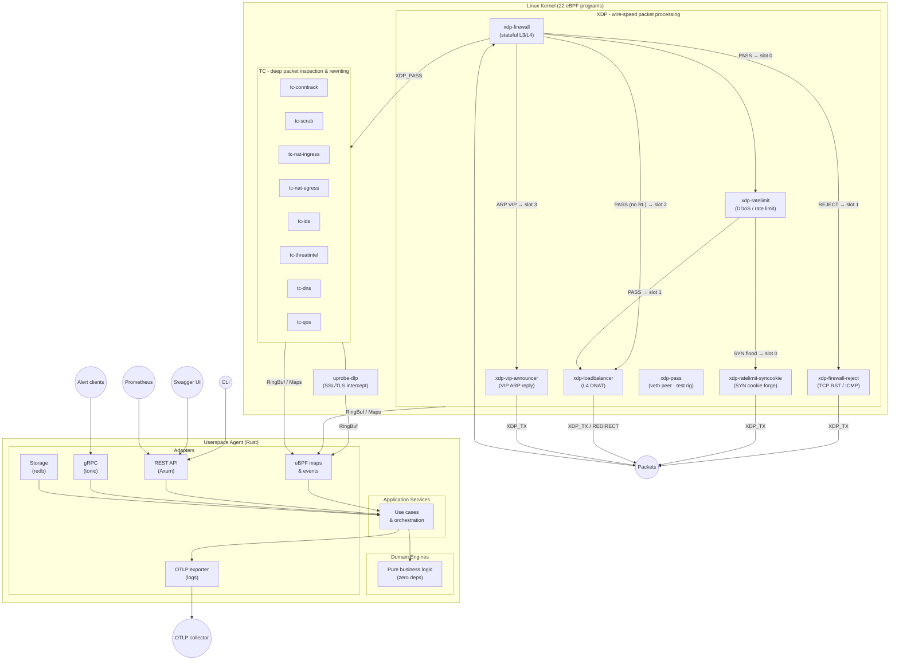

# Architecture Overview

eBPFsentinel is a single-binary agent with two execution layers:

1. **Kernel-space** - 22 eBPF programs attached at XDP, TC, uprobe, cgroup socket, raw tracepoint and BPF LSM hook points
2. **Userspace** - Rust async runtime (Tokio) with domain engines, API servers, and alert pipeline



## Crate Dependency Graph

| Crate | Role | Depends On |
|-------|------|-----------|
| `ebpf-common` | Shared `#[repr(C)]` types (kernel + userspace) | Nothing |
| `ebpf-helpers` | Shared helpers for the kernel programs (nightly, outside the workspace) | `ebpf-common` |
| `domain` | Business logic, engines, entities | `ebpf-common` |
| `ports` | Trait definitions (primary + secondary) | `domain`, `ebpf-common` |
| `application` | Use cases, pipelines, orchestration | `domain`, `ports`, `ebpf-common` |
| `infrastructure` | Config, logging, metrics | `domain` |
| `adapters` | HTTP, gRPC, eBPF, storage (redb), GeoIP | `domain`, `ports`, `infrastructure`, `ebpf-common`, `warden-client` |
| `warden-proto` | Wire messages between the agent and the warden | Nothing |
| `warden-client` | Agent side of the warden control socket (fd passing) | `warden-proto` |
| `warden` | Privileged broker binary and the syscall primitives it shares with the agent's rootless bootstrap | `warden-proto`, `warden-client` |
| `agent` | Binary entry point, startup | `domain`, `ports`, `application`, `adapters`, `infrastructure`, `ebpf-common`, `warden` |
| `xtask` | Build orchestration (eBPF multi-program builds) | `adapters`, `agent`, `ebpf-common` |

## Project Structure

```
ebpfsentinel/
├── Cargo.toml                        # Workspace root
├── Dockerfile                        # Multi-stage build
├── docker-compose.yml                # Deployment example
├── deny.toml                         # Dependency policy
├── config/
│   ├── ebpfsentinel.yaml             # Default config
│   └── examples/                     # Per-feature standalone configs (23 files)
├── proto/
│   └── ebpfsentinel/v1/alerts.proto  # gRPC service definition
├── crates/
│   ├── ebpf-common/                  # Shared #[repr(C)] types (kernel + userspace)
│   ├── ebpf-helpers/                 # Shared kernel-side helpers (nightly)
│   ├── ebpf-programs/                # eBPF kernel programs (nightly, bpfel-unknown-none)
│   │   ├── xdp-firewall/
│   │   ├── xdp-firewall-reject/
│   │   ├── xdp-ratelimit/
│   │   ├── xdp-ratelimit-syncookie/
│   │   ├── xdp-loadbalancer/
│   │   ├── tc-ids/
│   │   ├── tc-threatintel/
│   │   ├── tc-dns/
│   │   ├── tc-conntrack/
│   │   ├── tc-scrub/
│   │   ├── tc-nat-ingress/
│   │   ├── tc-nat-egress/
│   │   ├── tc-qos/
│   │   ├── uprobe-dlp/
│   │   ├── xdp-vip-announcer/
│   │   └── xdp-pass/
│   ├── domain/                       # Business logic (engines, entities, errors)
│   ├── ports/                        # Port traits (primary + secondary)
│   ├── application/                  # Use cases, pipelines, orchestration
│   ├── adapters/                     # HTTP, gRPC, eBPF, redb, GeoIP
│   ├── infrastructure/               # Config, logging, metrics
│   ├── warden/                       # Privileged broker (rootless deployments)
│   ├── warden-client/                # Agent side of the warden socket
│   ├── warden-proto/                 # Agent <-> warden wire messages
│   ├── agent/                        # Binary entry point
│   └── xtask/                        # Build orchestration
├── tests/integration/                # BATS integration tests
├── fuzz/                             # libFuzzer fuzz targets
└── .github/workflows/                # CI/CD pipelines
```

## Key Design Decisions

- **100% Rust** - kernel programs and userspace, no C, no Go
- **Aya framework** - compile-once eBPF with CO-RE/BTF support
- **Hexagonal/DDD** - domain logic has zero external dependencies
- **`#![forbid(unsafe_code)]`** on domain, ports, application, infrastructure, agent, warden-proto and warden-client; adapters deny it and allow it file by file where a syscall or a ring-buffer record needs it
- **One agent binary plus a small broker** - a privileged `warden` process delegates a BPF filesystem and hands file descriptors over; the agent, holding no capability, creates its own BPF token and loads its own programs
- **Source-agnostic feeds** - threat intel feeds are configured in YAML, no provider-specific code
- **MITRE ATT&CK mapping** - every alert tagged with tactic + technique ID
- **GeoIP enforcement** - MaxMind-backed country resolution shared across all engines
- **Hot reload** - configuration updates without restart (file watcher, SIGHUP, or API)
- **JWT/OIDC/API key auth** - role-based access control (Admin, Operator, Viewer)
- **TLS 1.3** - REST and gRPC secured with rustls + aws_lc_rs; TLS 1.2 only when explicitly allowed
- **OTLP export** - alerts as OpenTelemetry Logs to any OTLP-compatible collector
- **CLI** - 37 subcommands covering all endpoints
