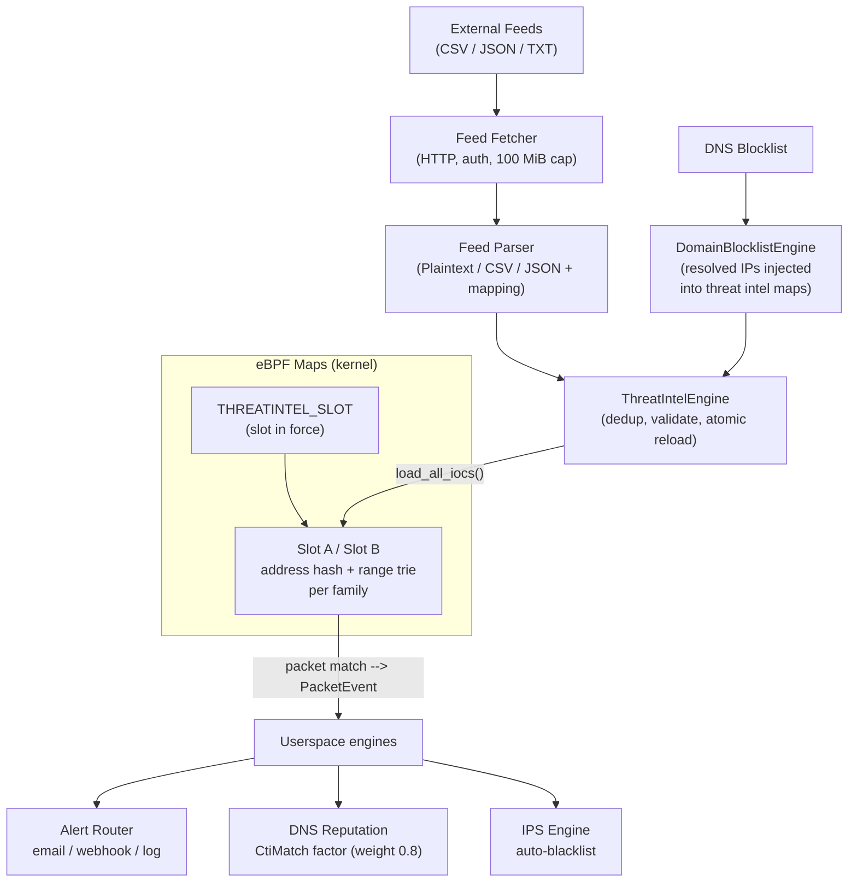

# Threat Intelligence

> **Edition: OSS** | **eBPF Program: tc-threatintel**

## Overview

Threat intelligence integrates external OSINT feeds into the packet processing pipeline for real-time IOC matching at wire speed. Feed configuration is **source-agnostic** - any provider that serves plaintext, CSV, or JSON data works through YAML field mappings, without any provider-specific code.

## Architecture

The threat intel system is **bidirectional**: external feeds flow down into the kernel, the kernel sends match events up to userspace, and userspace engines (DNS, reputation, IPS) can inject new IOCs back into the kernel maps.



## How It Works

### 1. Feed Ingestion

Feeds are fetched via HTTP/HTTPS on a configurable schedule (`refresh_interval_secs`). Each feed is independent - a failed fetch skips that feed without blocking others.

The fetcher enforces:
- **30-second timeout** per feed
- **100 MiB response cap** (prevents memory exhaustion)
- **Optional auth header** (e.g. `X-OTX-API-KEY: abc123`, `Authorization: Bearer ...`)
- **SSRF prevention** - only `http://` and `https://` schemes allowed

### 2. Feed Parsing (source-agnostic)

No provider-specific code. The parser dispatches by format, then uses `FieldMapping` to locate fields:

| Format | How IPs are extracted | Confidence | Category |
|--------|----------------------|------------|----------|
| `plaintext` | One address or CIDR range per line, comment lines skipped | Always 100 | `other` |
| `csv` | Column by name (`ip_field`) or index, configurable separator; address or CIDR range | Column by name (`confidence_field`) or default 100 | Column by name (`category_field`) |
| `json` | JSON array, field name from `ip_field`; address or CIDR range | Field name from `confidence_field` | Field name from `category_field` |
| `stix` | STIX 2.1 bundle, addresses and CIDR ranges from `ipv4-addr`/`ipv6-addr` indicator patterns; domains + URLs to their engines | Per-indicator, filtered by `min_confidence` | From indicator threat type |

Every format reads an indicator as one address or as a range in CIDR
notation, so lists published as networks (Spamhaus DROP, FireHOL, a CrowdSec
`Range` decision) are matched as networks: `198.51.100.0/24` catches every
address from `198.51.100.0` to `198.51.100.255`. Host bits below the prefix are
cleared (`192.0.2.7/24` is read as `192.0.2.0/24`), `/32` and `/128` are read as
one address, and a `/0` is refused, since it covers every address and a feed
carrying one would flag or block all traffic
(`parse_target_refuses_zero_and_oversized_prefixes` in
`crates/domain/src/threatintel/entity.rs`).

An address matches its own entry first, then the longest range holding it, in
the engine and in the kernel alike
(`the_address_wins_over_a_range_then_the_longest_range` in
`crates/domain/src/threatintel/engine.rs`,
`a_source_inside_a_listed_range_is_dropped` in
`crates/adapters/tests/ebpf_prog_test_run.rs`).

A list is applied as published. FireHOL `firehol_level1` includes the
`fullbogons` set, which carries the private ranges of RFC 1918, so a host
reaching or reached from `10.0.0.0/8` or `192.168.0.0/16` is matched by it
([FireHOL, firehol_level1](https://iplists.firehol.org/?ipset=firehol_level1)).
Load it in `alert` mode first, or on interfaces carrying only internet traffic.

Post-parse filters applied in order:
1. **`min_confidence`** - reject IOCs below this threshold (0 = accept all)
2. **`max_iocs`** - truncate if the feed returns too many entries (default: 500,000)

Category values are normalized: `"malware"/"mal"` → Malware, `"c2"/"c&c"/"botnet"` → C2, `"scanner"/"scan"` → Scanner, `"spam"` → Spam, anything else → Other.

### 3. Engine Storage (userspace)

The `ThreatIntelEngine` is a `HashMap` keyed by address and prefix length, so
a range and its first address are two entries:

- **Deduplication**: if the same address or range appears in multiple feeds, the highest-confidence entry wins
- **Atomic reload**: two-phase validation - all IOCs validated, then the entire map is swapped. On any error, the old map remains untouched
- **Capacity limit**: `max_iocs` per feed, and the kernel tables' capacity (`threatintel.max_entries`, see below) in total: a set larger than that is refused whole and the set in force stays

### 4. Kernel Sync (userspace → eBPF)

When feeds are reloaded, the `ThreatIntelMapManager` replaces the set the
kernel matches against. `tc-threatintel` holds two slots, A and B, and an
array, `THREATINTEL_SLOT`, naming the one it reads:

| Map | Type | Entries | Purpose |
|-----|------|---------|---------|
| `THREATINTEL_IOCS_A`, `THREATINTEL_IOCS_B` | Hash (`BPF_F_NO_PREALLOC`) | `threatintel.max_entries` | IPv4 addresses |
| `THREATINTEL_IOCS_V6_A`, `THREATINTEL_IOCS_V6_B` | Hash (`BPF_F_NO_PREALLOC`) | `threatintel.max_entries` | IPv6 addresses |
| `THREATINTEL_NETS_A`, `THREATINTEL_NETS_B` | LPM trie | `threatintel.max_entries` | IPv4 CIDR ranges |
| `THREATINTEL_NETS_V6_A`, `THREATINTEL_NETS_V6_B` | LPM trie | `threatintel.max_entries` | IPv6 CIDR ranges |
| `THREATINTEL_SLOT` | Array | 1 | The slot in force: 0 for A, 1 for B |

A reload is atomic for the datapath:

1. The new set is counted per table against `threatintel.max_entries`. A set
   that does not fit is refused before anything is written, the error names the
   table and the setting to raise, and the set in force stays.
2. The slot the datapath is not reading is emptied, then written.
3. `THREATINTEL_SLOT` is flipped: one 4-byte write, so a packet reads the old
   set or the new one and never a mix
   (`only_the_slot_the_selector_names_is_read` in
   `crates/adapters/tests/ebpf_prog_test_run.rs`).
4. After 20 ms, enough for a packet that read the selector before the flip to
   finish its lookups, the slot left behind is emptied.

A write that fails before the flip leaves the selector where it was. Nothing
is ever evicted: the tables are plain hash tables and tries, not LRU, so an
indicator stays until a reload takes it away. The tables are created with
`BPF_F_NO_PREALLOC`, so the locked memory of the idle slot is paid only while a
reload fills it.

Each IOC value in the map is 4 bytes: `{ action: u8, feed_id: u8, confidence: u8, threat_type: u8 }`.

The `action` field is written per IOC rather than per service, because a feed
carrying `default_action` overrides the service mode for its own indicators:

- **`alert`** → `THREATINTEL_ACTION_ALERT (0)` → `TC_ACT_OK` (pass packet, emit event)
- **`block`** → `THREATINTEL_ACTION_DROP (1)` → `TC_ACT_SHOT` (drop packet, emit event)

An IOC from a feed naming no `default_action` is loaded with the service mode,
so a service on `alert` holding one blocking feed drops that feed's matches and
passes every other. The alert an operator reads carries what the kernel did with
the packet rather than what the service mode says, so a match on a blocking feed
is reported as blocked even where the service is on `alert`.

The `feed_id` byte is the IOC's position in the batch that was loaded, not an
identifier of the feed it came from; the feed an alert names is resolved in
userspace, and so is the `ebpfsentinel_threatintel_matches_total{feed}` label.

The two address tables are written with the kernel's batched commands
(`BPF_MAP_UPDATE_BATCH`, `BPF_MAP_DELETE_BATCH`) in chunks of at most 4,096
elements, because a feed of a million indicators written one element at a time
is a million syscalls. The chunk is bounded on purpose: the kernel pins and
copies the whole chunk in one go, so an unbounded one turns a reload into a long
non-preemptible stretch. A kernel that does not carry the batched commands
answers the first chunk with `EINVAL` or `EOPNOTSUPP`, and the agent falls back
to writing element by element for the rest of its life rather than paying a
refused syscall per reload; the set that ends up in the table is the same either
way. The range tries are written one element at a time, since the agent's map
library reaches the batched commands on hash and array maps only. However long
the write takes, the datapath keeps matching the previous set until the flip.

How long a full reload took is published as
`ebpfsentinel_threatintel_reload_duration_seconds` with the number of
indicators it wrote as `ebpfsentinel_threatintel_reload_indicators`. The two
together are what says whether a feed has outgrown the host it is loaded on.

### 5. Kernel Matching (tc-threatintel, hot path)

The TC classifier processes every ingress packet:

```
Packet arrives
    │
    ├── CONFIG_FLAGS[0] == 0 ? → bypass (TC_ACT_OK)
    │
    ├── Parse Ethernet + VLAN 802.1Q
    │
    ├── THREATINTEL_SLOT → slot A or slot B
    │
    ├── For src_ip and dst_ip: address table, then range trie
    │   (longest prefix); a table userspace left empty is skipped
    │   └── Neither matched ? → TC_ACT_OK
    │
    └── Match → the stronger action of the two addresses
        ├── ALERT → TC_ACT_OK + emit PacketEvent to RingBuf
        └── DROP  → TC_ACT_SHOT + emit PacketEvent to RingBuf
```

**Backpressure**: event emission is skipped when the RingBuf is >75% full, protecting the kernel hot path when userspace falls behind.

### 6. Cross-Domain Enrichment

Threat intel match events feed into other engines, creating a **feedback loop**:

#### DNS → Threat Intel (IP injection)

When the DNS blocklist engine detects a blocked domain resolving to an IP, that IP is **automatically injected into the threat intel kernel tables**. This means:
- A domain blocklist entry like `*.malware.com` translates into real-time IP-level blocking
- IPs are managed with TTL awareness: injected when DNS resolves, removed when the DNS TTL expires (+grace period)
- The injection target is configurable: `ThreatIntel` (default), `Firewall`, or `Ips`

#### Threat Intel → Domain Reputation (scoring)

CTI matches contribute a `CtiMatch` reputation factor with **weight 0.8** into the domain reputation engine:
- Scoring uses probabilistic OR: `score = 1 - ∏(1 - weight_i)`
- Exponential decay: half-life 24 hours
- If effective score ≥ `auto_block_threshold` (default 0.8), the domain becomes an auto-block candidate

#### Threat Intel → IPS (blacklisting)

IPS blacklist additions for IPs involved in threat intel matches can be automated via the IPS engine.

#### GeoIP → Threat Intel (confidence boost)

The `country_confidence_boost` setting adjusts IOC confidence scores based on the source IP's country. Positive values increase confidence for IOCs from high-risk regions, making them more likely to trigger block actions:

```yaml
threatintel:
  country_confidence_boost:
    RU: 10       # +10 confidence for IOCs from Russia
    CN: 5        # +5 for China
    KP: 15       # +15 for North Korea
```

The boost is applied where the IOC is added and again on every feed reload, and
it needs GeoIP: with no GeoIP database configured nothing resolves a country, so
every entry in the table is inert and confidence stays as the feed stated it.
Values are clamped to the 0-100 range after adjustment. This is useful to prioritize IOCs from known high-risk regions when feeds have variable confidence scores.

## Configuration

```yaml
threatintel:
  enabled: true
  mode: alert          # "alert" or "block"

  feeds:
    # Plaintext - one address or CIDR range per line
    - id: spamhaus-drop
      name: Spamhaus DROP
      url: https://www.spamhaus.org/drop/drop.txt
      format: plaintext
      comment_prefix: ";"
      refresh_interval_secs: 86400

    # CSV - custom field mapping
    - id: feodo-tracker
      name: Feodo Tracker Botnet C2
      url: https://feodotracker.abuse.ch/downloads/ipblocklist.csv
      format: csv
      ip_field: dst_ip
      category_field: malware
      separator: ","
      skip_header: true
      min_confidence: 75
      refresh_interval_secs: 1800
      default_action: block

    # JSON - with auth header
    - id: otx-malicious
      name: AlienVault OTX
      url: https://otx.alienvault.com/api/v1/indicators/export
      format: json
      ip_field: indicator
      confidence_field: pulse_count
      category_field: type
      auth_header: "X-OTX-API-KEY: your-key-here"
      refresh_interval_secs: 3600
      max_iocs: 100000
```

See [Configuration: Threat Intelligence](../configuration/threatintel.md) for the full field reference.

## CrowdSec

The agent can stand in for a CrowdSec bouncer: with `threatintel.crowdsec.enabled`, the bans a CrowdSec local API holds are read every minute and loaded as indicators of the `crowdsec` feed, so a source banned by any CrowdSec machine on the network is dropped in the kernel on this host as well. Only bans on a single address are loaded; the rest is counted and logged.

It can also write back, off unless `report.enabled` is set too: once per interval the agent tells the local API which public sources it blocked, by component, how often and when, and nothing more. With `decision_duration` set, those reports become bans that every other bouncer of that local API enforces. Matches on indicators are never reported, so a ban read from CrowdSec does not come back to it as a fresh signal. Every field and the full list of what is and is not sent are in [Threat Intelligence Configuration](../configuration/threatintel.md#crowdsec).

## Feed Security

Feed ingestion enforces several hardening measures to prevent abuse:

- **SSRF prevention** - feed URLs are resolved before connection and rejected if the resolved IP falls within private (RFC 1918), loopback (`127.0.0.0/8`), link-local (`169.254.0.0/16`, `fe80::/10`), or multicast ranges. Only `http://` and `https://` URL schemes are accepted.
- **No HTTP redirects** - the HTTP client does not follow redirects, preventing redirect-based SSRF bypass.
- **Auth header CRLF injection prevention** - the `auth_header` value is validated to reject carriage-return and line-feed characters, preventing HTTP header injection.
- **JSON depth limit** - JSON feed parsing enforces a maximum nesting depth of 64 levels to prevent stack exhaustion from deeply nested payloads.

## CLI Usage

```bash
# Whether threat intel is on, the mode every match is capped at, and how
# many indicators and feeds stand behind it
ebpfsentinel-agent threatintel status

# List loaded IOCs (all feeds)
ebpfsentinel-agent threatintel iocs

# List URL IOCs (the ones the IP and domain lists cannot carry)
ebpfsentinel-agent threatintel urls

# List configured feeds
ebpfsentinel-agent threatintel feeds

# Refresh feeds now
ebpfsentinel-agent threatintel feeds refresh
```

`--feed-id` is accepted for forward compatibility and does not narrow the
cycle: the fetcher refreshes every enabled feed. One cycle runs at a time, so
a second caller is told a refresh is already running rather than queued behind
the first.

## REST API

| Method | Path | Description |
|--------|------|-------------|
| GET | `/api/v1/threatintel/status` | `enabled`, `mode`, and the totals behind them: `ioc_count` and `feed_count` |
| GET | `/api/v1/threatintel/iocs` | List loaded IOCs |
| GET | `/api/v1/threatintel/urls` | List loaded URL IOCs |
| GET | `/api/v1/threatintel/feeds` | List configured feeds |
| POST | `/api/v1/threatintel/feeds/refresh` | Refresh feeds now (not available to the `viewer` role) |

The status route answers the subsystem rather than the feeds: there is no
per-feed count and no error field on it, so a feed that failed its last fetch
is not visible there. What it does say is what a match will do, since `mode`
caps every IOC in the maps at once.

Each feed of `GET /api/v1/threatintel/feeds` carries its `id`, `name`, `url`,
`format`, `enabled`, `refresh_interval_secs`, `max_iocs`, `min_confidence` and
`last_fetched`. `last_fetched` is Unix-epoch milliseconds of the last completed
fetch **cycle**, and a cycle covers every enabled feed at once, so the value is
a property of the agent repeated on each row rather than of the feed it sits
on; it is `null` until a cycle has run.

`GET /api/v1/threatintel/iocs` is the address and range set the engine holds, served whole:
there is no filter, no paging and no cursor, so a caller asking an agent
carrying a million indicators is asking for all of them. Each item carries
`ip` (one address, or a range in CIDR notation such as `198.51.100.0/24`), `feed_id`, `confidence`, `threat_type` and `source_feed`, the feed's
configured name. `threat_type` is one of `malware`, `c2`, `scanner`, `spam`
or `other` and never a feed's own wording, because the parser normalizes every
category it reads into those five. `GET /api/v1/threatintel/urls` answers the
indicators the IP set cannot carry, with `url`, `feed_id`, `confidence` and
`threat_type` and no `source_feed`.

## Code Architecture

| Crate | Path | Role |
|-------|------|------|
| `ebpf-common` | `crates/ebpf-common/src/threatintel.rs` | Shared `#[repr(C)]` types (keys, values, constants) |
| `ebpf-programs` | `crates/ebpf-programs/tc-threatintel/` | TC classifier: A/B slots, address hash then range trie |
| `domain` | `crates/domain/src/threatintel/` | Engine (IOC store), parser (Plaintext/CSV/JSON), entities |
| `ports` | `crates/ports/src/secondary/threatintel_map_port.rs` | `ThreatIntelMapPort` trait (eBPF map writes) |
| `ports` | `crates/ports/src/secondary/feed_source.rs` | `FeedSource` trait (HTTP fetch) |
| `application` | `crates/application/src/threatintel_service_impl.rs` | App service (thin wrapper + metrics) |
| `application` | `crates/application/src/feed_update.rs` | Feed fetch orchestration + JSON parser |
| `adapters` | `crates/adapters/src/threatintel/http_feed_fetcher.rs` | `FeedSource` impl (reqwest, auth, size cap) |
| `adapters` | `crates/adapters/src/ebpf/threatintel_map_manager.rs` | `ThreatIntelMapPort` impl (slot write, flip, capacity check) |

## Metrics

- `ebpfsentinel_alerts_total{component="threatintel", severity}` - threat intel alerts generated
- `ebpfsentinel_threatintel_matches_total{feed}` - IOC matches, by the feed that resolved them
- `ebpfsentinel_rules_loaded{component="threatintel"}` - total loaded IOC count
- `ebpfsentinel_packet_processing_duration_seconds{program="threatintel"}` - threat intel event dispatch latency
- `ebpfsentinel_rules_reloads_total{component="threatintel", result}` - per-feed fetch outcome (`success` or `failure`)
- `ebpfsentinel_threatintel_reload_duration_seconds` - how long one full reload of the indicator sets into the eBPF maps took
- `ebpfsentinel_threatintel_reload_indicators` - indicators the last full reload wrote
