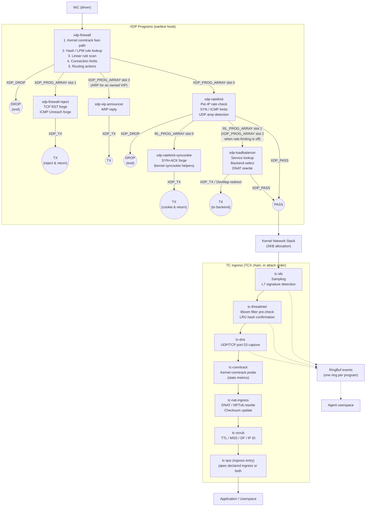
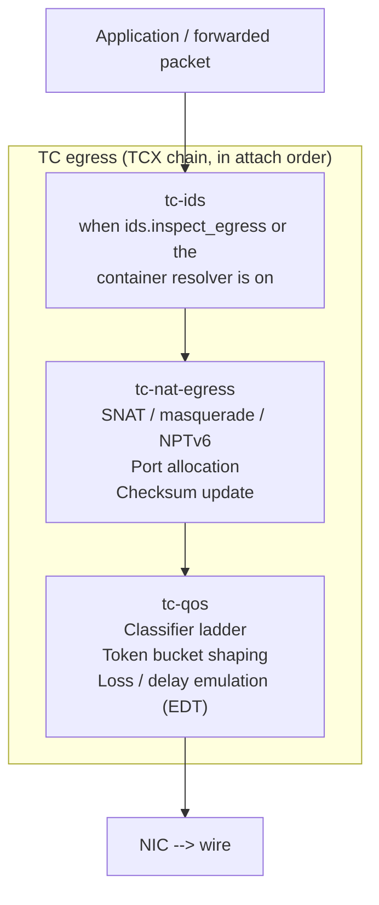
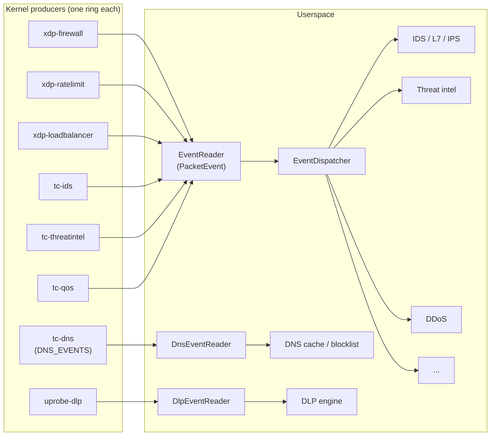

# Packet Pipeline

The full kernel-side packet processing pipeline, from NIC to userspace.

## Ingress Pipeline



Every TC program is attached as a TCX link (kernel 6.6+, no qdisc) appended at the tail of the interface's chain, so the chain runs in the order the agent loads the programs. Only the programs whose feature is enabled are loaded; the diagram shows all of them.

## Egress Pipeline



On egress the kernel has bound the originating socket to the skb, which is why tc-ids is attached there for container attribution: `bpf_skb_cgroup_id` returns the cgroup of the process that sent the packet.

## One Parse per TC Chain

XDP and TC do not share metadata: no program calls `bpf_xdp_adjust_meta`, and every TC program reads the `sk_buff` itself. What is shared is the parse **within** a TC chain. The classifier hook exposes 20 bytes of `skb->cb` that survive from one program of a chain to the next, so the first program to parse a packet leaves what it found there and the ones behind it read it back instead of walking the headers again:

| Word | Content |
|------|---------|
| 0 | magic byte, VLAN ID, flags, L4 protocol |
| 1 | L3 offset, L4 offset |
| 2 | source port, destination port |
| 3 | tenant ID |
| 4 | check word |

The words are guarded rather than trusted: the check word folds the four payload words together with the packet length, the interface the packet is on and the interface it came in by. A locally originated skb carries the transport's own control block in the same bytes and a forwarded one carries what another device's chain wrote, so either fails the check and is parsed again. The two NAT programs invalidate the block after they rewrite a packet, so the programs behind them parse the rewritten packet.

## RingBuf Event Flow

Each event-emitting program has a [`BPF_MAP_TYPE_RINGBUF`](https://docs.ebpf.io/linux/map-type/BPF_MAP_TYPE_RINGBUF/) of its own; ring buffers are never shared between program objects. Userspace runs one reader per ring and funnels the packet events into one dispatcher:



tc-dns emits `DnsEvent` records and uprobe-dlp `DlpEvent` records; every other program emits `PacketEvent`.

### PacketEvent Structure (96 bytes)

```
Offset  Field             Type             Notes
------  ----------------  ---------------  ------------------------------------
 0      timestamp_ns      u64 (8 B)        bpf_ktime_get_boot_ns()
 8      src_addr          [u32; 4] (16 B)  IPv4: [addr, 0, 0, 0]
                                           IPv6: [a, b, c, d]
24      dst_addr          [u32; 4] (16 B)
40      src_port          u16 (2 B)
42      dst_port          u16 (2 B)
44      protocol          u8  (1 B)        6=TCP, 17=UDP, 1=ICMP
45      event_type        u8  (1 B)        0=FW, 1=IDS, 2=IPS, 3=DLP, 4=RL,
                                           5=TI, 6=L7, 7=DNS, 8=QoS
46      action            u8  (1 B)        pass / drop / log
47      flags             u8  (1 B)        FLAG_IPV6, FLAG_VLAN, FLAG_TCP
48      rule_id           u32 (4 B)        matched rule ID (0 = none); for L7
                                           events, the captured payload length
52      vlan_id           u16 (2 B)        802.1Q VLAN ID (0 = none)
54      cpu_id            u16 (2 B)        bpf_get_smp_processor_id()
56      socket_cookie     u64 (8 B)        0 in XDP
64      cgroup_id         u64 (8 B)        cgroup v2 ID, 0 when unknown
72      cgroup1_id        u64 (8 B)        cgroup v1 inode (bpf_task_get_cgroup1)
80      rss_hash          u32 (4 B)        NIC RSS hash (XDP only)
84      rss_hash_type     u32 (4 B)        RSS hash type bitmask
88      rx_hw_timestamp   u64 (8 B)        NIC RX timestamp (XDP only)
------
Total: 96 bytes, #[repr(C)], aligned to 8 bytes
```

L7 events from tc-ids reserve a larger record with the payload after the header (512 or 2,048 bytes of payload, whichever fits).

`timestamp_ns` is boot-relative inside the kernel: `bpf_ktime_get_boot_ns()`
counts from the last boot, not from 1970. Userspace converts it to nanoseconds
since the Unix epoch as the record leaves the ring buffer, in the same place
that measures how long the record queued, so every alert, audit record and
export carries an epoch stamp whether it was raised in the kernel or in
userspace. A stamp of `0` means "no time" and stays `0`.

### Backpressure

Every packet program that emits events checks the ring's fill level first:

```
avail = bpf_ringbuf_query(&EVENTS, BPF_RB_AVAIL_DATA)
if avail > capacity * 75 / 100:
    metrics[EVENTS_DROPPED] += 1
    return                    // skip the event, the packet verdict is unchanged
```

This prevents kernel-side event buildup when the userspace consumer is slow. uprobe-dlp does not apply the cut; it counts a failed reservation as a drop.

Records are submitted with `BPF_RB_NO_WAKEUP` while less than 64 KiB is waiting and with `BPF_RB_FORCE_WAKEUP` above that, so a steady event rate wakes the reader once per batch.

## Map Sharing (BPF Filesystem Pinning)

Maps are pinned by name under `/sys/fs/bpf/ebpfsentinel/`, and a map declared under the same name by several programs is one map in the kernel. The ones that carry state between programs:

| Map | Programs | Purpose |
|-----|----------|---------|
| `PKT_CTX` | xdp-firewall, xdp-firewall-reject | Parsed packet handed to the reject tail call |
| `SYNCOOKIE_CTX`, `DDOS_METRICS` | xdp-ratelimit, xdp-ratelimit-syncookie | SYN cookie context and shared counters |
| `CT_CONFIG`, `CT_NF_CONN_OFFSETS` | xdp-firewall, tc-conntrack | Conntrack thresholds and runtime `nf_conn` offsets |
| `INTERFACE_GROUPS` | xdp-firewall, xdp-ratelimit, tc-ids, tc-nat-ingress, tc-nat-egress, tc-qos | Interface group membership |
| Tenant maps | every program resolving a tenant | VLAN, ifindex and subnet to tenant |

Connection state itself is the kernel's: xdp-firewall and tc-conntrack look it up through the netfilter conntrack kfuncs, and no program keeps a connection table of its own. Userspace updates the other maps (firewall rules and LPM tries, rate limit policies, threat intel IOCs, IPS blocks written into the firewall LPM tries) in place, without reloading a program. See [Map Types](maps.md) for the full inventory.
