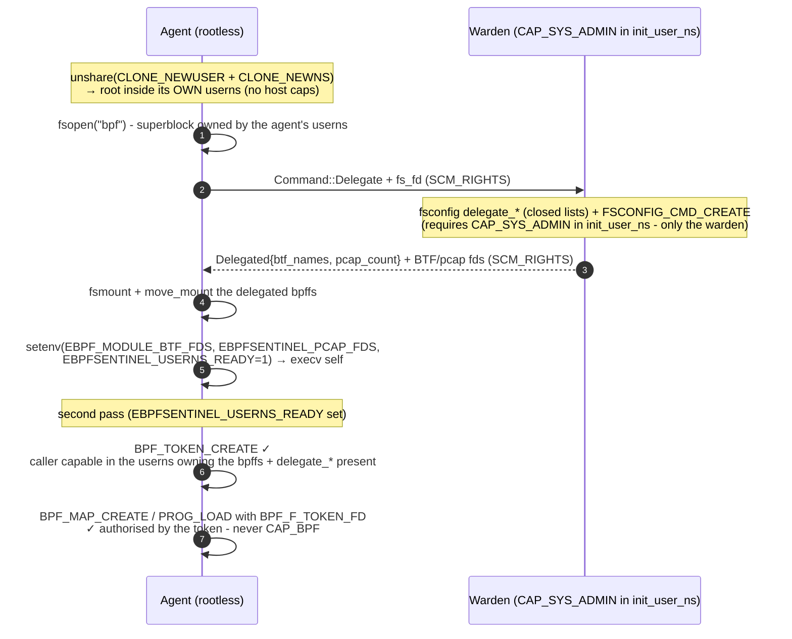

# BPF token delegation

> **The only loading path.** eBPFsentinel loads eBPF **exclusively** through a
> BPF token; the agent never loads programs with `CAP_BPF`, and
> there is no capability-based fallback. The deployment is two components: a
> small privileged **warden** broker and the **rootless agent**. The agent
> self-unshares a user namespace, has the warden delegate a bpffs over a shared
> socket, and creates the token there - holding **no** capabilities over the
> host.

## What is BPF token delegation?

Kernel 6.9 introduced `BPF_TOKEN_CREATE` (`bpf(2)` command #36) and the
`BPF_F_TOKEN_FD` flag. A token is created against a delegated bpffs mount whose
options scope which BPF commands, map types, program types, and attach types the
token-bearer may use. Any subsequent `bpf()` syscall by a process holding the
token fd is authorised by the token instead of by `CAP_BPF`.

`BPF_TOKEN_CREATE` succeeds only when **two** conditions hold for the target
bpffs:

1. its superblock is **owned by a user namespace the caller is in**, and
2. it was created with the `delegate_cmds` / `delegate_maps` / `delegate_progs` /
   `delegate_attachs` mount options.

These two conditions fall on opposite sides of the capability boundary, which is
why eBPFsentinel splits the bpffs setup between the agent and the warden.

## The trampoline: how the agent creates a token without host privilege

At startup the agent runs a single-threaded **trampoline** (before any async
runtime), then re-execs itself to continue normally. The trampoline and the
warden split the bpffs setup precisely along the capability boundary:



**Why the warden is required.** Applying the `delegate_*` mount options and
creating the superblock (`FSCONFIG_CMD_CREATE`) is gated on `CAP_SYS_ADMIN` in
the **initial** user namespace. The agent, in a descendant user namespace, holds
`CAP_SYS_ADMIN` only over *its own* namespace - never over the host - so it
fails that one step. It passes the `fs_fd` to the warden over `SCM_RIGHTS`, the
warden stamps the delegation, and the agent resumes. Token creation and every
later `bpf()` then happen entirely in the agent's own user namespace.

**What the token carries.** Each list goes only as far as the agent's own
objects go. The kernel reads a token on three commands, so only those three are
delegated, and only the map types the shipped objects create:

| Option | Values |
|---|---|
| `delegate_cmds` | `map_create`, `prog_load`, `btf_load` |
| `delegate_maps` | `hash`, `array`, `prog_array`, `percpu_hash`, `percpu_array`, `lru_hash`, `lru_percpu_hash`, `lpm_trie`, `hash_of_maps`, `devmap`, `ringbuf`, `user_ringbuf` |
| `delegate_progs` | `xdp`, `sched_cls`, `kprobe`, `cgroup_skb`, `cgroup_sock`, `cgroup_sock_addr`, `sock_ops`, `raw_tracepoint`, `lsm`, `syscall` |
| `delegate_attachs` | `cgroup_inet_ingress`, `cgroup_inet_egress`, `cgroup_inet_sock_release`, the `cgroup_inet4/6` `bind`, `post_bind`, `connect` and `getpeername` hooks, the `cgroup_udp4/6` `sendmsg` and `recvmsg` hooks, `cgroup_sock_ops`, `xdp`, `tcx_ingress`, `tcx_egress`, `trace_uprobe_multi`, `trace_kprobe_multi`, `trace_kprobe_session`, `lsm_mac` |

An agent that is taken over gets no `tracing`, `perf_event` or `struct_ops`
program out of the token. A program loaded with no attach type carries `0`,
which the kernel spells `cgroup_inet_ingress`, and that entry is what lets the
XDP, TC, raw tracepoint and syscall programs load. If the kernel refuses any
option, the warden refuses the whole delegation rather than hand back a token
narrower than the agent needs, and the agent says so at start-up.

The trampoline is a no-op when no warden socket is configured
(`EBPFSENTINEL_WARDEN_SOCK` unset) or on the post-`execv` second pass
(`EBPFSENTINEL_USERNS_READY` set).

## The warden broker

The warden is a small privileged binary (`warden serve <socket> [--uid <n> | --user <name>] [--policy <file>]`) that
loads no eBPF and holds no maps. It runs in the **initial network namespace**
with `CAP_SYS_ADMIN` / `CAP_NET_ADMIN` / `CAP_NET_RAW`, plus `CAP_SYS_PTRACE` /
`CAP_BPF` / `CAP_PERFMON` for DLP, and answers only a
narrow, typed, peer-authenticated protocol over an `AF_UNIX` socket:

- **bpffs delegation** + handing back the module-BTF fds (so module kfuncs like
  `nf_conntrack` / `fou` resolve in the agent) and the pre-opened `AF_PACKET`
  pcap fds.
- **conntrack** table read, single-flow teardown, and flush.
- **route** programming (multi-WAN failover).
- **gratuitous ARP** on VIP takeover.
- on-demand **pcap** capture sockets.
- the DLP **`/proc` scan** for processes linking `libssl` (reading another
  process's `/proc/<pid>/root` needs `CAP_SYS_PTRACE`), and the **attach of
  every program that reads the kernel**, which the warden holds (below).
- the **executable behind a pid** (`/proc/<pid>/exe`), which names the binary
  in process identities and DLP alerts. The link is guarded by a ptrace access
  check the agent fails against every process outside its own user namespace,
  so the warden answers with a path, a device and an inode, and nothing else.

One uid is served, checked via `SO_PEERCRED`, and it is never root: on bare
metal the agent runs as its own `ebpfsentinel` user and the warden is started
with `--user ebpfsentinel`; in a container, or started as root by hand, the
agent drops to `65534` before unsharing and the warden serves its default,
`65534`. `--uid <n>` names a numeric id instead; `--uid` and `--user` together
are refused.

### Load before input, hand over

On the floor kernel, creating a raw tracepoint, `kprobe_multi` or
`uprobe_multi` link checks no capability: whoever holds the descriptor of such a
program chooses which kernel function or which process it reads. So the agent
does not keep them. Under a warden, before it opens a listener or reads a byte
of input, the agent:

1. loads every object that reads the kernel (process, signal, drop-reason and
   TCP health tracepoints, the DLP and crypto uprobes, the four LSM objects);
2. hands each tracepoint, kprobe and uprobe program to the warden, which keeps
   one only under a name and a type it knows, and closes its own copy.

From then on the agent names a held program and, for a uprobe, the executable
and offset; the warden attaches the raw tracepoints to the one tracepoint
compiled in for each and the kTLS kprobes to their fixed symbols. The agent
loads no kernel-reading object after the hand-over: a feature asking for one it
did not load at start-up is answered with a restart. The LSM programs stay with
the agent: their attach point is fixed by the program itself.

The agent keeps the capabilities it was started with, `CAP_PERFMON` included,
because the datapath needs them. The hand-over stops a compromised agent from
aiming a program we shipped somewhere else; what stops it from loading a
program of its own is the kernel refusing an unsigned load, which needs `bpf`
in `lsm=` ([which distributions boot with it](../compatibility.md#the-bpf-lsm-at-boot)).
`ebpfsentinel-agent ebpf host-check` answers for your host.

The answer is on each host:

```bash
ebpfsentinel-agent ebpf kernel-features
curl -s localhost:8080/api/v1/ebpf/kernel-features | jq .preload
```

`preload.handed_over`, the programs the warden holds in `preload.held`, and
when nothing was handed over the reason (no warden configured: the agent then
loads each object when a feature asks for it and attaches every program
itself).

### What the warden answers

Serving one uid says who may ask; the policy says what that uid may ask for.
The agent binary writes it from the configuration the agent will read, before
the warden starts:

```bash
ebpfsentinel-agent --config /etc/ebpfsentinel/config.yaml warden-policy \
  --output /run/ebpfsentinel/warden-policy.json
```

and the warden reads it once, at `serve ... --policy <file>`. Every family of
requests the configuration does not use is refused, and the families it does
use are fenced by the values it names:

| Family | On when | Fenced to |
|---|---|---|
| `routing` | `routing.enabled` | the default route through each configured gateway, on its interface |
| `neighbour` | the load balancer announces (`loadbalancer.announce.role` not `disabled`) | the configured VIPs, on the announce interface |
| `conntrack-restore` | high availability is on (enterprise) | |
| `runtime` | `container.docker` or `container.podman` enabled | those runtimes |
| `file-watch`, `write-refusal` | `file_watch.enabled`, `file_watch.write_refusal.enabled` | the canary paths the configuration names |
| `uprobe` | `dlp.enabled` or `file_watch.enabled` | |
| `resolver` | `dns.allowlist.enabled` | `dns.allowlist.listen` |
| `hidden-ports`, `hidden-processes` | `hidden_checks.ports` / `.processes` enabled | the probed ports |
| `package-inventory`, `network-inventory` | the inventory is enabled | |
| `extension` | an enterprise feature needs one (extended TLS discovery) | the extensions named |

What the datapath needs on every host (bpffs delegation, the module-BTF and
pcap fds, conntrack read and teardown, the executable behind a pid) belongs to
no family and is always answered. A refused request is answered `Refused` with
its family and reason, and the warden logs
`[warden] refused (<family>): <reason>`; at start it logs the families it
switched on. A warden started without `--policy` answers only what belongs to
no family.

The policy is the configuration as it stood when the warden started. A setting
changed later that needs another family, or another gateway, VIP or port,
reaches the warden at its next restart: `systemctl restart ebpfsentinel-warden
ebpfsentinel`, a new rollout of the chart, or
`docker compose up -d --force-recreate warden-policy warden`. The file is
written by root (or, in a pod, by a container holding no capability) into a
directory the agent cannot write, and the agent never reads it, so a
compromised agent cannot widen what it may ask.

## Capability matrix

The agent holds **no** host capabilities. Everything it cannot do from its user
namespace is either an in-kernel eBPF path or brokered to the warden, which holds
the capabilities in the init network namespace:

| Operation | Path | Held by |
|-----------|------|---------|
| All eBPF load/attach (firewall, IDS, IPS, DLP, DNS, DDoS, NAT, QoS, LB) | BPF token | agent (token) |
| IPS active flow-kill | eBPF `bpf_ct_change_timeout` collapsing the conntrack entry (tc-ids, xdp-firewall) | agent (token) |
| Load-balancer VIP reply | eBPF `xdp-vip-announcer` (XDP_TX) | agent (token) |
| pcap manual/auto capture | `AF_PACKET` fd opened by the warden, passed to the agent | warden (`CAP_NET_RAW`) |
| Conntrack snapshot / event poller | warden reads `/proc/net/nf_conntrack` | warden (init netns) |
| Conntrack retroactive teardown on a new deny rule | warden netlink | warden (`CAP_NET_ADMIN`) |
| Multi-WAN policy routing (`ip rule` / `ip route`) | warden netlink | warden (`CAP_NET_ADMIN`) |
| Gratuitous ARP on VIP takeover | warden `AF_PACKET` | warden (`CAP_NET_RAW`) |
| DLP target discovery (`libssl` in other processes and containers) | warden `/proc` scan | warden (`CAP_SYS_PTRACE`) |
| DLP and crypto uprobe attach, kTLS kprobes | warden `BPF_LINK_CREATE` on a program it holds, named by the agent | warden (`CAP_BPF` + `CAP_PERFMON`) |
| Process, signal, drop-reason and TCP health raw tracepoints | warden attaches the program it holds to the one tracepoint compiled in for it | warden (`CAP_BPF` + `CAP_PERFMON`) |
| Executable behind a process (process identity, DLP alert) | warden reads `/proc/<pid>/exe` | warden (init user namespace) |

Because the warden runs in the init network namespace, the host-netns operations
that a userns agent cannot perform (conntrack teardown, route programming,
gratuitous ARP, packet capture, DLP uprobe attach) **all work** - they are brokered, not dropped.

### Why not just run the agent as root?

The blocker is the user namespace, not the user ID, and the two requirements are
mutually exclusive:

- **Root inside the agent's user namespace**: capabilities apply only to
  resources owned by that namespace. The host network namespace is owned by the
  *initial* user namespace, and a descendant is never privileged over an
  ancestor - so the agent's `CAP_NET_ADMIN` is unusable against the host netns.
  This is exactly why those operations are brokered to the warden.
- **Root in the initial user namespace**: those caps would work, but
  `BPF_TOKEN_CREATE` returns `EOPNOTSUPP` outside a user namespace, so the agent
  could not load **any** eBPF.

The split resolves the contradiction: the agent gets its token inside its own
userns, and the warden - which genuinely lives in the init namespace - performs
the host-netns operations on its behalf.

## systemd deployment

`dist/install.sh` installs both binaries and two units: `ebpfsentinel-warden.service`
(the broker) and `ebpfsentinel.service` (the agent, which `Wants` the warden and
waits for its socket before starting).

```ini
# ebpfsentinel-warden.service
ExecStartPre=/usr/local/bin/ebpfsentinel-agent --config /etc/ebpfsentinel/config.yaml warden-policy --output-file /run/ebpfsentinel/warden-policy.json
ExecStart=/usr/local/bin/warden serve /run/ebpfsentinel/warden.sock --user ebpfsentinel --policy /run/ebpfsentinel/warden-policy.json

# ebpfsentinel.service
User=ebpfsentinel
Group=ebpfsentinel
CapabilityBoundingSet=
AmbientCapabilities=
ProtectSystem=strict
TemporaryFileSystem=/sys/fs/bpf:mode=1777
StateDirectory=ebpfsentinel
Environment=EBPFSENTINEL_WARDEN_SOCK=/run/ebpfsentinel/warden.sock
ExecStartPre=/bin/sh -c 'for _ in $(seq 1 100); do [ -S /run/ebpfsentinel/warden.sock ] && exit 0; sleep 0.1; done; exit 1'
ExecStart=/usr/local/bin/ebpfsentinel-agent --config /etc/ebpfsentinel/config.yaml
```

The agent is never root. `install.sh` and the packages create a system user,
`ebpfsentinel`, with no login; the agent unit runs as it with an empty
capability bounding set, and its user namespace's root maps onto it, so a
compromised agent owns its state directory, `/var/lib/ebpfsentinel`, and
nothing else on the host. The configuration is `root:ebpfsentinel` at `0640`:
the agent reads it and cannot rewrite it. A file the configuration names (a
TLS key, a JWT public key, a feed, the enterprise licence) must be readable by
the group `ebpfsentinel` as well.

The host's `/sys/fs/bpf` belongs to root, so the unit gives the agent a tmpfs
there, in a mount namespace of its own, and the agent creates the directory the
delegated bpffs is mounted on. Do not set `NoNewPrivileges` on the agent unit:
under it AppArmor refuses the transition into the agent's profile, which is
what grants the user namespace on Ubuntu.

### Unprivileged user namespaces, per distribution

The agent creates its user namespace as an unprivileged user, so the host must
allow that user one. When it does not, the agent names the setting that refused
it before exiting.

| Distribution | Default | What the agent needs |
|---|---|---|
| Ubuntu 24.04 and later | `kernel.apparmor_restrict_unprivileged_userns=1` | the shipped AppArmor profile for the agent binary, loaded by the package and `install.sh`; nothing host-wide |
| Debian 13 | allowed (`kernel.unprivileged_userns_clone=1`) | nothing; a host hardened to `0` needs it back at `1` |
| Fedora | allowed | nothing |
| openSUSE Tumbleweed | allowed | nothing |
| Arch Linux | allowed | nothing |
| NixOS | allowed (`security.allowUserNamespaces = true`) | nothing; the module refuses to build with it off |
| Talos, Flatcar, Bottlerocket | allowed | nothing; these run the agent in a container |

A hardening baseline (CIS, STIG) that sets `user.max_user_namespaces=0` refuses
the agent on every distribution: the agent needs exactly one namespace per
start, so `user.max_user_namespaces=1` is enough where a baseline wants the
lowest number.

```bash
sudo bash dist/install.sh                       # agent, warden, eBPF programs, units
sudo systemctl enable --now ebpfsentinel-warden ebpfsentinel
curl -s localhost:9090/metrics | grep bpf_token_used   # expect value 1
```

## Docker deployment

`docker compose up` runs two containers - the `warden` broker (image
`ebpfsentinel-warden`, holding the capabilities) and the rootless `agent` (image
`ebpfsentinel`, uid 65534, `cap_drop: ALL`) - sharing the control-socket volume.
The compose file and the agent's seccomp profile are release assets of their
own, `compose.yaml` and `ebpfsentinel-agent.json`, signed and listed in
`ebpfsentinel-SHA256SUMS`; the [Docker guide](docker.md#docker-compose) fetches
and verifies them. From the directory holding both and your configuration:

```bash
# The agent runs as uid 65534 and rejects a world-readable config:
sudo chown 65534:65534 ebpfsentinel.yaml && sudo chmod 640 ebpfsentinel.yaml
docker compose up -d
docker compose logs -f
```

The warden container holds `CAP_SYS_ADMIN` / `CAP_NET_ADMIN` / `CAP_NET_RAW` /
`CAP_SYS_PTRACE` / `CAP_BPF` / `CAP_PERFMON` with
`apparmor=unconfined` + `seccomp=unconfined` (it does `fsconfig` + netlink +
`AF_PACKET` + the DLP uprobe link), on a read-only root filesystem. The
runtime's profiles are off because the warden installs a stricter one of its
own before it serves; see the
[security model](../../architecture/security-model.md). The agent container holds **no** capabilities but still runs
`apparmor=unconfined` and a tailored seccomp profile
(`ebpfsentinel-agent.json`, published with every release: the Docker default plus an
unconditional allow for `unshare` / the `mount` family / `bpf`): it self-unshares
a user namespace and issues those syscalls, and without `CAP_SYS_ADMIN` the
default profile (which gates them on `CAP_SYS_ADMIN`) would block them.
A container's `/sys` is read-only, so the agent backs its bpffs mountpoint with a
`tmpfs` at `/sys/fs/bpf`. See the [full Docker guide](docker.md) for the
container-awareness mounts.

## Kubernetes deployment

The Helm chart runs the warden as a **native sidecar** (an init container with
`restartPolicy: Always`) plus the agent as the main container, sharing an
`emptyDir` socket volume.

```yaml
# values.yaml - the warden sidecar holds the capabilities …
daemonset:
  warden:
    securityContext:
      runAsUser: 0
      capabilities:
        add: [SYS_ADMIN, NET_ADMIN, NET_RAW, SYS_PTRACE, BPF, PERFMON, DAC_READ_SEARCH]
        drop: [ALL]
      appArmorProfile: { type: Unconfined }
      seccompProfile: { type: Unconfined }
  # … the agent holds none
  securityContext:
    runAsUser: 65534
    runAsGroup: 65534
    capabilities:
      drop: [ALL]
    allowPrivilegeEscalation: true
    appArmorProfile: { type: Unconfined }
    seccompProfile: { type: Unconfined }
```

The agent's `Unconfined` seccomp profile is the chart's default only.
`daemonset.tailoredSeccomp.enabled=true` installs the same tailored profile the
compose deployment uses on each node and runs the agent under it as
`Localhost`; see
[Kubernetes deployment](kubernetes.md#tailored-seccomp-profile-for-the-agent).

`daemonset.bpfToken.bpffsPath` drives both the agent's `EBPFSENTINEL_BPFFS` mount
target and its `agent.bpf_token.bpffs_path` config. The agent mounts the
delegated bpffs in an in-memory `emptyDir` at `/sys/fs/bpf`, never on the node's
bpffs: that one belongs to root (`0700` where systemd mounted it), and the
agent's uid could not create a mountpoint in it.
See the [full Kubernetes guide](kubernetes.md) for the complete DaemonSet.

```bash
helm install ebpfsentinel oci://ghcr.io/ebpfsentinel/charts/ebpfsentinel \
  --version <version> \
  --namespace ebpfsentinel --create-namespace \
  --set agent.interfaces='{eth0}'
```

> **Note:** nested user namespaces + bpffs delegation inside a pod can require
> cluster-specific runtime configuration (the node must allow unprivileged user
> namespaces; some Pod Security Admission levels or runtimes block
> `CAP_SYS_ADMIN`). On nested runtimes such as **kind** or **minikube** the node
> is itself a container with no bpffs - set
> `daemonset.bpfToken.pinLinksOnNode=false`, and the extra user-namespace layer can require relaxed runtime settings. Validate on
> your cluster before rolling out fleet-wide.

## Troubleshooting

**Metric `ebpfsentinel_bpf_token_used` reads `0` / log says "BPF token
unavailable - running in API-only mode".**
The agent could not create a token (no eBPF attached). The usual cause is that
the warden was unreachable at startup (`EBPFSENTINEL_WARDEN_SOCK` unset, or the
broker not yet listening). Confirm the warden is running and the socket exists
before the agent starts.

**Agent logs `warden self-bootstrap failed` / `fsopen` / `unshare USER` errors.**
The host disallows unprivileged user namespaces, or (the warden) lacks
`CAP_SYS_ADMIN`. On an AppArmor host that restricts them
(`kernel.apparmor_restrict_unprivileged_userns=1`, Ubuntu 24.04 and later), load
the agent's own profile, `/etc/apparmor.d/ebpfsentinel-agent`, which the package
and `install.sh` install: `sudo apparmor_parser -r -W /etc/apparmor.d/ebpfsentinel-agent`.
It grants `userns` to the agent alone. Setting the sysctl to `0` is the fallback
where no profile can be loaded, and lifts the restriction for every binary.
Elsewhere the agent names the setting that refused it: see
[the table above](#unprivileged-user-namespaces-per-distribution). A container
warden needs `CAP_SYS_ADMIN`.

**Agent logs `move_mount: No such file or directory` or "bpffs path does not
exist" (container only).**
A container's `/sys` is mounted read-only, so the agent cannot create the bpffs
mountpoint there. Give the agent a **writable `/sys/fs/bpf`**: bind in the host
bpffs (`-v /sys/fs/bpf:/sys/fs/bpf` / a `hostPath` volume), or mount a tmpfs
(`--tmpfs /sys/fs/bpf` / an `emptyDir: { medium: Memory }`).

**Agent logs `mount`/`move_mount` denied, or `uid_map: Operation not permitted`.**
The container's AppArmor or seccomp profile is blocking the agent's mount and
user-namespace setup. Run it unconfined - `--security-opt apparmor=unconfined
--security-opt seccomp=unconfined` (Docker) or `appArmorProfile.type: Unconfined`
+ `seccompProfile.type: Unconfined` (Kubernetes).

**The warden rejects the agent (`rejecting peer uid …`).**
The uid the warden serves must be the one the agent presents over
`SO_PEERCRED`: the `ebpfsentinel` user on a host (`--user ebpfsentinel` in the
shipped unit), `65534` in a container or for an agent started as root by hand,
which drops to it before unsharing. Root is never served.

**The warden answers `Refused` (`[warden] refused (<family>): ...`).**
The request belongs to a family the configuration did not use when the warden
started, or names a gateway, VIP, port or path it does not. Restart the warden
after the configuration change so its policy is written again; see
[what the warden answers](#what-the-warden-answers).

**A conntrack teardown, route change, or VIP ARP does nothing.**
Confirm the warden is reachable - these are brokered to it. If the agent runs
without a warden (`EBPFSENTINEL_WARDEN_SOCK` unset), they are unavailable while
the eBPF datapath (including the conntrack-timeout flow-kill and `xdp-vip-announcer`) keeps
working.
